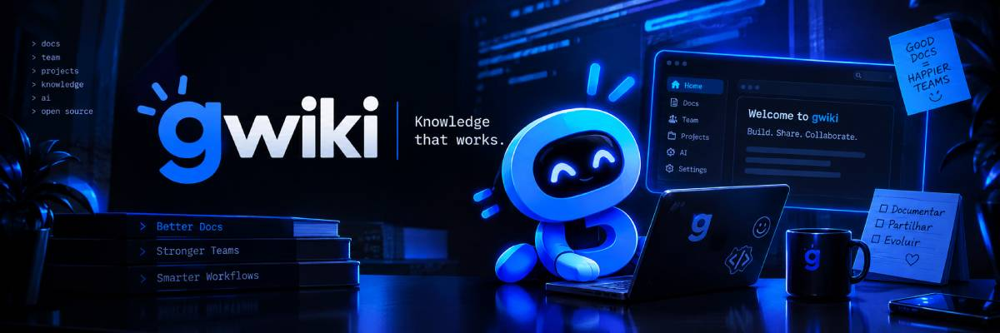
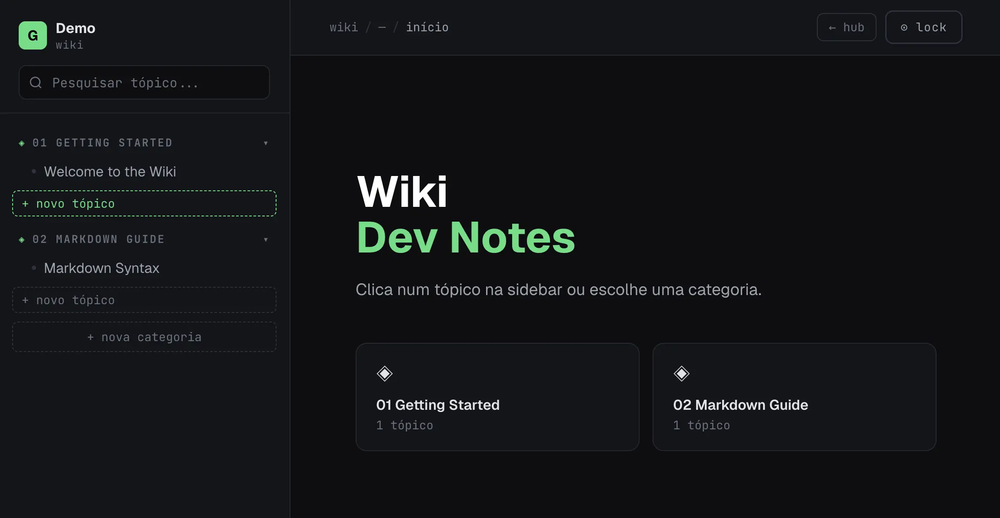
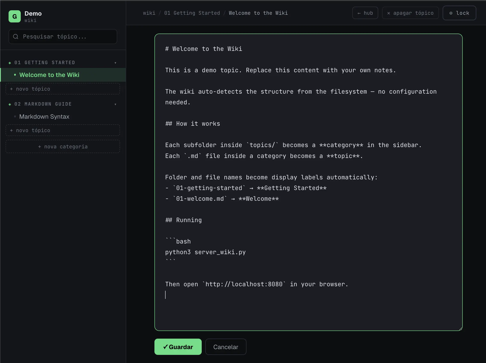

# GWiki

A lightweight personal wiki. Self-hosted, single-file frontend, Python stdlib server, zero dependencies.





## Stack

- `index.html` — all CSS and JS inline, no build step, no npm
- `server_wiki.py` — Python stdlib HTTP server with a small REST API
- Custom regex Markdown parser (no external library)

## Running

```bash
python3 server_wiki.py
# open http://localhost:8080
```

No install, no build step.

## Server modes

The server auto-detects the mode on startup:

- **Standalone** — a single `topics/` folder at root → goes straight to the wiki
- **Hub** — multiple sub-wiki folders at root → shows a card grid to pick one

## Content structure

```
<wiki-root>/
└── <sub-wiki>/          # hub mode only
    ├── topics/
    │   └── <category-slug>/
    │       ├── <topic-slug>.md
    │       ├── <topic-slug>.html
    │       └── images/
    ├── cover.webp        # wiki hero image (optional)
    └── description.txt   # wiki tagline (optional)
```

Category and topic names are derived from folder/file slugs (hyphens → spaces, words capitalised). No config files.

## Admin & password

Append `?admin` to the URL to enter admin mode. On first visit a password is set; subsequent visits require it.

The password is stored as a salted SHA-256 hash in `.butterfly` at the server root. To reset, delete that file — the next `?admin` visit will prompt for a new password.

Session token is stored in `localStorage` (persists across page reloads) and sent as `Authorization: Bearer <token>`. Every write endpoint (create/edit/delete/rename) requires it.

## Editing

Click the **lock** button to unlock edit mode. Clicking any topic opens an inline editor. Save writes directly to the file.

**Markdown topics** — split-pane editor with live preview.

**HTML topics** — WYSIWYG editor with toolbar: bold, italic, underline, headings, lists, links, image upload. Images can be resized by dragging corner handles. Paste from clipboard to upload directly.

## Hub features

- **Sub-wiki hero** — each wiki shows a cover image, name, and short description on its welcome page. Click to upload/edit in unlock mode. Drag the corner handle to resize the cover image.
- **Hub card thumbnails** — wikis with a cover image show it as a banner on their hub card.
- **Animated subtitle** — the hub subtitle cycles through customisable words with random text effects (scramble, glitch, wave, rainbow, and more).
- **Settings panel** — accessible in hub-unlock mode (⚙ settings). Configure hub title, title color, subtitle color, rotating word list, and the sidebar logo (letter or uploaded image).
- **Logo** — change the sidebar logo letter or upload an image (`/logo.webp`, served from the server root — works across devices).
- **Rename / delete** — categories and sub-wikis can be renamed or deleted in unlock mode.
- **Drag-and-drop ordering** — reorder categories and topics by dragging; order is saved per list.
- **Category labels** — give a category a custom display name and color, with a generated QR code (deep link) and JPEG/PDF export.

## Deep links

Navigation updates the URL hash so any page can be bookmarked or shared via QR code:

```
/?admin#wiki=my-wiki&cat=my-category&slug=my-topic
```

## API

Write endpoints (`PUT`/`DELETE`/`POST` except `/api/auth`) require `Authorization: Bearer <token>`.

| Method | Path | Description |
|--------|------|-------------|
| `GET` | `/api/topics[?wiki=]` | Category/topic tree |
| `GET` | `/api/topic?cat=&slug=[&wiki=]` | Raw file content + type |
| `GET` | `/api/settings` | Hub settings (title, colors, logo, rotating words) |
| `GET/POST` | `/api/auth[?token=]` | Password auth — GET: status/validate token; POST `{password}`: verify/set, returns token |
| `PUT` | `/api/topic?cat=&slug=[&wiki=]` | Save content |
| `PUT` | `/api/description?wiki=` | Save wiki description (`description.txt`) |
| `PUT` | `/api/settings` | Save hub settings |
| `PUT` | `/api/order?type=topics\|categories&wiki=&cat=` | Save manual order (array of slugs) |
| `PUT` | `/api/wiki?wiki=` | Rename sub-wiki |
| `PUT` | `/api/label?cat=&wiki=` | Save category label (`name`, `color`) |
| `PUT` | `/api/category?cat=&wiki=` | Rename category |
| `POST` | `/api/topic` | Create topic (`name`, `type`: `md`\|`html`) |
| `POST` | `/api/category` | Create category |
| `POST` | `/api/wiki` | Create sub-wiki (hub mode) |
| `POST` | `/api/image?cat=&filename=[&wiki=]` | Upload image (raw binary body); omit `cat` to write to wiki/server root |
| `DELETE` | `/api/topic?cat=&slug=[&wiki=]` | Delete topic |
| `DELETE` | `/api/category?cat=&wiki=` | Delete category (recursive) |

## Deployment (Linux service)

```bash
sudo systemctl daemon-reload
sudo systemctl restart gwiki
sudo systemctl status gwiki
```
